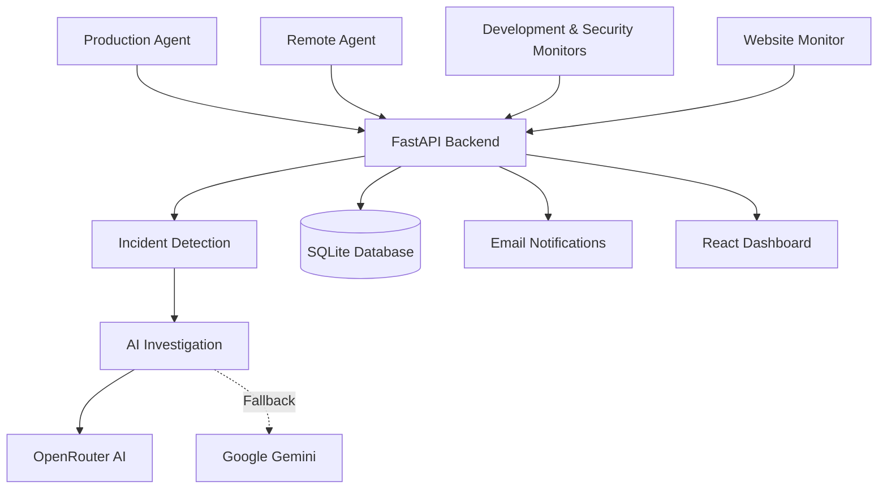

# SentinelAI — Multi-Agent Production Monitoring & Recovery System

**An AI-powered multi-agent system for real-time infrastructure monitoring, intelligent incident investigation, and security alerting.**

SentinelAI is designed to monitor production systems, detect unusual activities, investigate incidents using AI, and provide actionable recovery recommendations through a centralized dashboard.

## 🚀 Key Features

- **Real-Time System Monitoring:** Tracks CPU usage, RAM consumption, and disk utilization.
- **AI-Powered Incident Investigation:** Uses OpenRouter AI with Gemini fallback to analyze incidents and suggest possible root causes and remedies.
- **Multi-Agent Architecture:** Separates production monitoring, development monitoring, and remote system monitoring.
- **Security Monitoring:** Detects suspicious activities, including SQL injection patterns, command injection, directory traversal, and failed login attempts.
- **Website Monitoring:** Checks website availability and sends email notifications when websites go down or recover.
- **Remote Server Monitoring:** Tracks remote agent heartbeats and online/offline status.
- **Email Notifications:** Sends alerts for critical incidents and security events.
- **Centralized Dashboard:** Displays system metrics, incidents, AI investigations, security alerts, and website monitoring history.

## 🏗️ System Architecture

## 🏗️ System Architecture



## 🛠️ Technology Stack

| Category | Technologies |
|---|---|
| Backend | Python, FastAPI |
| Frontend | React.js, Vite, CSS |
| AI Integration | OpenRouter API, Google Gemini |
| Database | SQLite |
| System Monitoring | psutil |
| Security Monitoring | Windows Event Logs, Python |
| Communication | REST APIs, HTTP |
| Notifications | SMTP Email |
| Version Control | Git, GitHub |

## 📂 Project Structure

```text
SentinelAI-MultiAgent/
│
├── development_agent/
│   ├── main.py
│   ├── ai_client.py
│   ├── investigation.py
│   ├── security_monitor.py
│   ├── log_watcher.py
│   ├── website_monitor.py
│   ├── windows_event_monitor.py
│   └── email_alerts.py
│
├── production_agent/
│   ├── main.py
│   ├── config.py
│   ├── heartbeat.py
│   └── monitor.py
│
├── remote_agent/
│   ├── main.py
│   ├── api_client.py
│   ├── config.py
│   ├── system_monitor.py
│   └── collectors/
│
├── frontend/
│   ├── src/
│   │   ├── App.jsx
│   │   ├── Dashboard.jsx
│   │   ├── App.css
│   │   └── api.js
│   └── package.json
│
├── shared/
│   └── database.py
│
├── requirements.txt
└── README.md
```

## ⚙️ Installation and Setup

### Prerequisites

- Python 3.10 or later
- Node.js and npm
- Git
- OpenRouter API key
- Google Gemini API key (optional fallback)

### 1. Clone the Repository

```bash
git clone https://github.com/ADITHYASHETTY250/SentinelAI-MultiAgent.git
cd SentinelAI-MultiAgent
```

### 2. Create a Python Virtual Environment

```bash
python -m venv .venv
```

Activate it on Windows:

```powershell
.venv\Scripts\activate
```

### 3. Install Backend Dependencies

```bash
pip install -r requirements.txt
```

### 4. Configure Environment Variables

Create a `.env` file in the project root:

```env
OPENROUTER_API_KEY=your_openrouter_api_key
OPENROUTER_MODEL=deepseek/deepseek-v3.2

GEMINI_API_KEY=your_gemini_api_key

SENTINELAI_ADMIN_EMAIL=your_admin_email
SMTP_EMAIL=your_gmail_address
SMTP_APP_PASSWORD=your_gmail_app_password
```

Add your actual credentials locally. Never commit your `.env` file or expose API keys publicly.

### 5. Start the Backend

Open a terminal in the project root:

```powershell
python -m uvicorn development_agent.main:app --host 127.0.0.1 --port 8001 --reload
```

Backend API:

`http://127.0.0.1:8001`

API documentation:

`http://127.0.0.1:8001/docs`

### 6. Start the Frontend

Open another terminal:

```powershell
cd frontend
npm install
npm run dev
```

Frontend:

`http://localhost:5173`

### 7. Start the Monitoring Agents

Open separate terminals from the project root.

**Production Agent**

```powershell
python -m production_agent.heartbeat
```

**Remote Agent**

```powershell
python -m remote_agent.main
```

**Website Monitor**

```powershell
python -m development_agent.website_monitor
```

**Log Security Monitor**

```powershell
python -m development_agent.log_watcher
```

**Windows Security Event Monitor**

Run PowerShell as Administrator:

```powershell
python -m development_agent.windows_event_monitor
```

## 🤖 AI Investigation

SentinelAI integrates AI into its incident investigation workflow.

When an incident is detected:

1. The backend receives monitoring data.
2. The incident detection system identifies the issue.
3. The AI investigation module analyzes the incident.
4. OpenRouter is used as the primary AI provider.
5. Gemini is available as a fallback provider.
6. The investigation report is stored in SQLite.
7. The dashboard displays the AI analysis and recommendations.

**Important:** SentinelAI provides investigation reports and suggested remedies. It does not automatically execute production recovery actions.

## 🔐 Security Monitoring

The security monitoring components check for suspicious patterns and Windows security events.

Examples include:

- SQL injection attempts
- Directory traversal
- Command injection
- Failed login attempts
- Suspicious activity in Windows Security Event Logs

Critical security events can trigger email notifications.

## 📊 Dashboard

The React dashboard provides a centralized view of:

- Production system health
- CPU, RAM, and disk metrics
- Incident history
- AI investigation reports
- Security alerts
- Website availability and history
- Remote agent status

## 🔮 Future Enhancements

- Automated and approval-based recovery workflows
- Advanced anomaly detection using machine learning
- Container and cloud infrastructure monitoring
- Role-based authentication and access control
- More detailed incident analytics
- Support for additional monitoring agents

## 👨‍💻 Developer

**Adithya Shetty**

GitHub: [@ADITHYASHETTY250](https://github.com/ADITHYASHETTY250)

Project: [SentinelAI-MultiAgent](https://github.com/ADITHYASHETTY250/SentinelAI-MultiAgent)

---

**SentinelAI — Monitor. Investigate. Recover.**